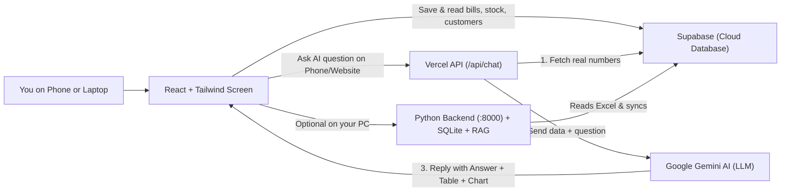
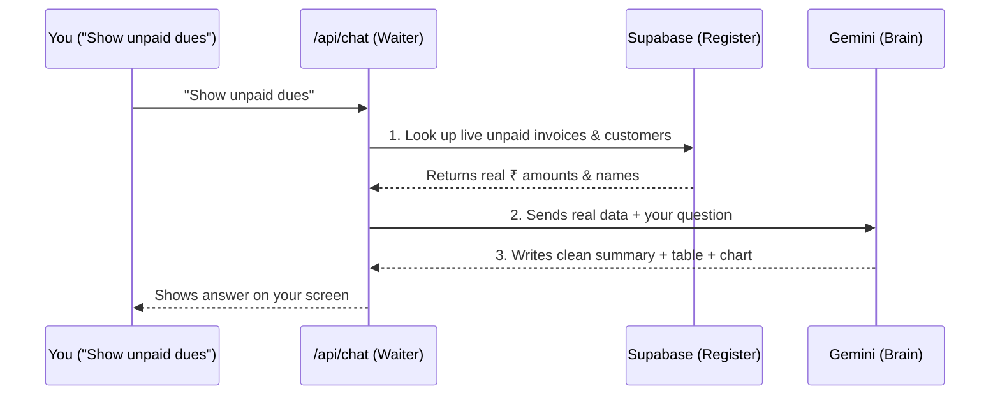

# Sai Gayatri Industries — Easy App Guide (How We Built It & Every Tool Explained)

> **Made for easy reading:** No textbook jargon. Just clear, everyday English explaining **what each tool is, why we used it, and how it works** inside your app — plus diagrams and how Mobile vs Laptop UI/UX were designed.

---

## 1. Big Picture: How Everything Connects

---

## 2. Every Tool Explained in Easy Language

For each tool below, you'll see:
- **What is it?** — simple meaning
- **Why we used it** — what problem it solves
- **How it works in our app** — what it actually does

---

### 1) React — *The Screen Builder*
- **What is it?** A tool for building app screens out of small reusable blocks (called **components**), like Lego pieces.
- **Why we used it:** Instead of rewriting buttons, headers, and forms on every page, we build a block once (like `SaleForm` or `Topbar`) and reuse it everywhere. When you add a sale, React updates only the changed numbers on screen without reloading the whole page.
- **How it works in our app:**
  - `src/App.tsx` is the main frame.
  - Each screen (`Home`, `Sales`, `Categories`, `AIChatPage`, `OrderQueries`) is a React page loaded only when you tap it (`React.lazy`), keeping the phone app fast.

---

### 2) TypeScript — *The Mistake Catcher*
- **What is it?** JavaScript with labels on every piece of data (for example, saying `price` must be a number and `customerName` must be text).
- **Why we used it:** Prevents silly bugs (like adding text to a number or misspelling a database field) **before** you even upload the app to Vercel.
- **How it works in our app:** Every time we run `npm run build`, TypeScript (`tsc -b`) checks all files for errors first.

---

### 3) Vite — *The Fast Packer*
- **What is it?** A build tool that takes all our React, TypeScript, and CSS files and packs them into tiny, fast files that phones and browsers can open quickly.
- **Why we used it:** Older tools are slow. Vite starts in under a second while coding and builds the full production app in ~2 seconds.
- **How it works in our app:** `npm run dev` runs the live preview on your PC; `npm run build` creates the `dist/` folder that Vercel publishes.

---

### 4) Tailwind CSS — *The Designer & Mobile/Laptop Switcher*
- **What is it?** A styling tool where you write short design words directly on elements (like `rounded-full`, `bg-[#FAF5EE]`, `text-[#2B1810]`).
- **Why we used it:**
  1. Keeps our **Chocolate Truffle** colors consistent everywhere.
  2. Makes it super easy to show one layout on **Mobile** and a different layout on **Laptop** using `md:` (which means *"on medium/laptop screens and bigger"*).
- **How it works in our app:** For example, `BottomNav` has `md:hidden` (shows on Mobile, hides on Laptop), while `Sidebar` has `hidden md:flex` (hides on Mobile, shows on Laptop).

---

### 5) React Router — *The Page Switcher*
- **What is it?** The navigation manager that connects URLs (`/home`, `/sales`, `/categories`, `/ai-chat`) to their screens.
- **Why we used it:** So tapping **Categories** or **AI** switches screens instantly like a real mobile app without a white flash or full page reload.
- **How it works in our app:** Defined in `src/App.tsx` (`<Routes>` and `<Route>`).

---

### 6) Supabase — *Our Cloud Register (Database)*
- **What is it?** A cloud **PostgreSQL database** that stores all your business records online safely.
- **Why we used it:** If data was only saved inside your phone browser, your laptop wouldn't see it. With Supabase, if you enter a sale on your phone at the shop, it appears on your laptop immediately.
- **How it works in our app:** Stores 8 main tables: `sales`, `sale_products`, `products`, `customers`, `suppliers`, `stock_intakes`, `expenses`, and `orders`.

---

### 7) API & Vercel Serverless Functions — *The Safe Messenger*
- **What is an API?** Think of an **API** like a waiter in a restaurant:
  - Your phone app (the customer) asks the waiter (`/api/chat`) for something.
  - The waiter goes to the kitchen (Supabase + Gemini), gets the answer, and brings it back.
- **Why we used Vercel Serverless (`api/chat.ts`, `api/health.ts`):**
  1. Your phone **cannot** connect to `http://localhost:8000` on your laptop when you are at the shop.
  2. You should **never** put your secret `GEMINI_API_KEY` inside the React frontend (anyone could steal it).
  3. Vercel runs `api/chat.ts` in the cloud only when someone sends a message, keeping `GEMINI_API_KEY` hidden in **Vercel Secrets**.

---

### 8) Python Backend (`FastAPI` + `SQLite` + `Pandas`) — *Your Local PC Helper*
- **What is it?** A Python server (`backend/main.py`) that runs on your laptop (`localhost:8000`) when needed.
- **Why we used it:** Great for heavy local work on your PC:
  - **Pandas:** Reads `.xlsx` Excel sheets cleanly.
  - **SQLite:** Fast local file database for running SQL queries on synced Excel/Supabase data.
  - **FastAPI:** Exposes local endpoints (`/api/chat`, `/api/sync/folder`, `/api/config`).
- **How it fits with Vercel:** On your **PC** you can use Python `:8000`; on **Mobile / Live Website**, the app automatically uses **Vercel `/api/chat`** instead so it works anywhere!

---

### 9) RAG (Retrieval-Augmented Generation) — *Check the Register First!*
- **What is it?** A simple 3-step trick that stops AI from guessing or making up fake numbers:
  1. **Retrieve (Look up):** Find the real matching invoices, customers, stock, and expenses from Supabase/SQLite.
  2. **Augment (Attach):** Attach those real numbers to your question.
  3. **Generate (Answer):** Let the AI read those real numbers and write a clear answer.
- **Why we used it:** Normal AI knows general English, **not** your shop's daily sales or pending dues. RAG gives the AI your live shop facts before it speaks.

---

### 10) LLM & Google Gemini API — *The Smart Brain*
- **What is an LLM?** **Large Language Model** — an AI trained to understand normal human questions (even short/casual ones like *"RG Catering unpaid?"*) and reply clearly.
- **What is Gemini API?** Google's service that lets our app send a question + live data to **Gemini** (`gemini-2.5-flash` / `gemini-2.0-flash`) using your `GEMINI_API_KEY` and get back structured JSON (`answer`, `metrics`, `columns`, `rows`, `chart`, `suggestions`).
- **Why we used it:** Turns raw database rows into easy-to-read summaries, KPI cards, tables, and bar charts automatically.

---

### 11) jsPDF + AutoTable — *The PDF Bill Printer*
- **What is it?** A browser library that creates downloadable PDF files.
- **Why we used it:** So you can tap an invoice or report and export a clean, printable PDF on mobile or laptop without needing extra software.

---

### 12) Git, GitHub & Vercel — *Save & Publish Pipeline*
- **Git:** Tracks every change we make to the code (so nothing is ever lost).
- **GitHub:** Stores the project online (`Gayatri-Software-Solution-Sales-Deck`).
- **Vercel:** Watches GitHub — every time we push an update, Vercel automatically builds and updates your live website and mobile web app in ~30 seconds.

---

## 3. How We Built It Stage by Stage

| Stage | What We Built | Tools Used |
| :--- | :--- | :--- |
| **Stage 1: App Skeleton** | All pages & smooth navigation | React, TypeScript, Vite, React Router |
| **Stage 2: Look & Icons** | Chocolate Truffle colors + matching custom SVG icons (`AppIcons.tsx`) | Tailwind CSS, custom SVGs |
| **Stage 3: Live Cloud Data** | Synced Sales, Stock, Customers, Expenses, Queries & Quick Sale | Supabase (PostgreSQL), jsPDF |
| **Stage 4: AI Assistant** | Ask questions in plain English & get real ₹ tables/charts | RAG, Google Gemini API, Vercel `/api/chat`, Python FastAPI |
| **Stage 5: Mobile vs Laptop UX** | Clean mobile header, Categories hub, dedicated AI tab, pill nav | Tailwind responsive rules (`md:`) |
| **Stage 6: Live Launch** | Auto-deploy updates from code push to live phone/web | Git, GitHub, Vercel |

---

## 4. Mobile vs Laptop UI/UX — What Is Different & Why

```mermaid
flowchart TB
    subgraph MOBILE["Mobile View (< 768px) — Made for One-Thumb Use"]
        M1["Clean Top Header: Logo + Title + '+ Sale' button (No cramped search bar)"]
        M2["Swipeable Icon Strip: Sales | Users | Inventory | Finance | Queries"]
        M3["Focused Screen: Home (KPIs only) OR AI Chat (Full page) OR Categories Hub"]
        M4["Floating Pill Bottom Nav: Home | Categories | AI | Sales"]
        M1 --> M2 --> M3 --> M4
    end

    subgraph LAPTOP["Laptop View (>= 768px) — Made for Wide Screens"]
        L1["Left Fixed Sidebar (All 10+ sections visible at once)"]
        L2["Top Header Bar + Quick Buttons"]
        L3["Wide Multi-Column Tables, Charts & Forms"]
        L4["Floating 'Ask AI Chart' Drawer (Bottom-Right)"]
        L1 --- L2
        L2 --> L3
        L3 --- L4
    end
```

| Part of App | On Mobile (Phone) | On Laptop (Desktop) | Why We Made It Different |
| :--- | :--- | :--- | :--- |
| **Main Menu** | Floating bottom pill (`Home`, `Categories`, `AI`, `Sales`) | Left fixed `Sidebar` | Phones need thumb-friendly bottom buttons; laptops have wide side space. |
| **Finding Tools** | **Categories** screen (like Flipkart/Amazon: left rail + 2-column cards) | Direct links in Sidebar | Easy one-tap browsing on a small screen without long menus. |
| **AI Assistant** | Own dedicated **AI** tab with full breathing space | Floating bottom-right AI button/drawer | Keeps the Home dashboard clean on mobile while giving AI full screen space. |
| **Header** | Logo + Title + `+ Sale` + swipeable icon strip | Full topbar with quick actions | Removed search bar on mobile because AI handles lookups cleanly. |
| **Forms (New Sale / Query)** | Step-by-step cards with bottom sticky buttons above pill nav | Wide multi-column layout | Prevents buttons from overlapping or hiding behind the bottom nav bar. |
