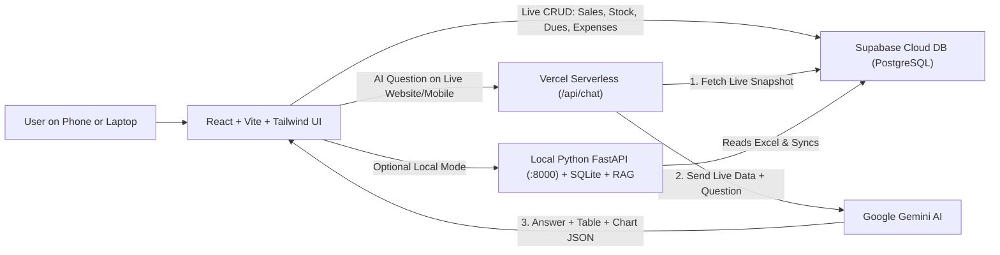
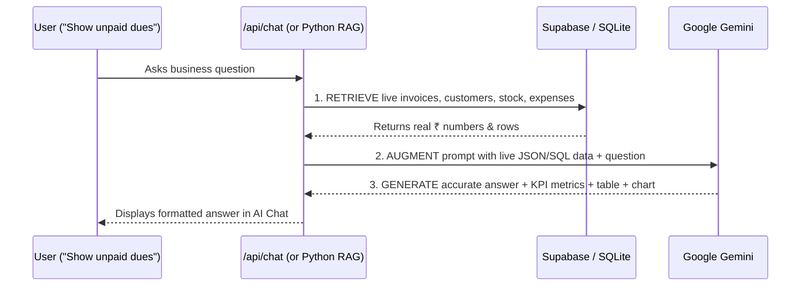

# Sai Gayatri Industries — Complete App Build & Architecture Notes

> **One-page practical guide** explaining how this app was built stage by stage, every tool we used (in plain English, not textbook theory), how **RAG + Gemini + Supabase** work together, and how we designed **separate Mobile vs Laptop UI/UX**.

---

## 1. Big Picture: How the App Works End-to-End

---

## 2. Stage-by-Stage Build Journey

### Stage 1 — App Skeleton & Routing (`React` + `TypeScript` + `Vite` + `React Router`)
- **What we built:** A multi-page web app (`Home`, `Categories`, `AI Chat`, `Sales`, `New Sale`, `Inventory`, `Queries`, `Finance`, `Users`, `Reports`) inside `src/App.tsx`.
- **Why these tools:**
  - **React** builds each screen as reusable building blocks (components) like `SaleForm`, `AIChatWidget`, `Topbar`, and `BottomNav`.
  - **React Router** switches pages instantly (`/home`, `/sales`, `/ai-chat`, `/categories`) without reloading the browser.
  - **Vite** bundles everything in ~2 seconds (`npm run build`) and powers fast live reload during development.
  - **Lazy Loading (`React.lazy`)** loads each page only when opened, keeping mobile startup fast.

### Stage 2 — Brand Theme & Custom Icons (`Tailwind CSS` + `AppIcons.tsx`)
- **What we built:** The **Chocolate Truffle** design system:
  - Warm cream background (`#FAF5EE`), crisp card surface (`#FFFDF9`), deep espresso text (`#2B1810`), roasted brown actions (`#5C3317` / `#8C4A1F`), and hairline borders (`#E6D7C3`).
- **Custom Vector Icons (`src/components/Icons/AppIcons.tsx`):**
  - Replaced inconsistent emojis with clean matching SVG icons: `SalesTagIcon`, `InventoryCycleIcon`, `UserOutlineIcon`, `FinanceCycleIcon`, `AIChatBotIcon`, and `QuickAccessIcon`.
  - Used the **exact same icons** across `Topbar`, `Sidebar`, `BottomNav`, and `Categories` so users recognize every section instantly.

### Stage 3 — Cloud Database (`Supabase`)
- **What we built:** Real-time cloud persistence so data created on a laptop appears immediately on mobile (and vice versa).
- **Tables stored in Supabase:** `sales`, `sale_products`, `products`, `customers`, `suppliers`, `stock_intakes`, `expenses`, `orders`.
- **Quick Business Flows:**
  - **New Sale / Quick Sale:** Select customer & product, auto-calculate totals, mark `Paid` / `Partial` / `Unpaid`, save straight to Supabase.
  - **Payment Clearance:** Mark unpaid/partial invoices as paid with one tap inside AI Chat or Sales.
  - **Clickable Invoices & PDF Export:** Generate formatted PDF invoices and reports using `jsPDF` + `jspdf-autotable`.

### Stage 4 — AI Business Assistant (`Gemini AI` + `RAG` + `Vercel Serverless`)
- **What we built:** An AI Business Intelligence assistant that answers real questions like *"Show unpaid dues"*, *"Compare monthly sales"*, or *"RG Catering history"* using **live database numbers**, not guesses.
- **Two execution modes:**
  1. **Cloud Mode (Mobile & Live Website):** Browser calls `/api/chat` on **Vercel** (`api/chat.ts`), which fetches live Supabase rows and sends them to **Google Gemini** (`gemini-2.5-flash` / `gemini-2.0-flash`).
  2. **Local PC Mode (Optional):** Python **FastAPI** (`backend/main.py` on port `8000`) with **SQLite** + **RAG index** + Excel folder sync.

### Stage 5 — Mobile-First vs Laptop UX Redesign
- **What we fixed from real phone testing:**
  1. Removed the cramped mobile search bar from the header.
  2. Separated **Home** (clean business overview & KPIs) from **AI Chat** (dedicated full-screen `/ai-chat` tab) so both screens have breathing space.
  3. Added a **swipeable top icon strip** (`Sales`, `Users`, `Inventory`, `Finance`, `Queries`).
  4. Added an Amazon/Flipkart-style **Categories & Quick Access hub** (`src/pages/Categories.tsx`) with a left rail and 2-column action grid.
  5. Replaced awkward long scrolling forms with structured step-by-step cards and sticky bottom action bars that never hide behind the navigation pill.

### Stage 6 — Deployment & Version Control (`Git` + `GitHub` + `Vercel`)
- Every code edit is tested with `npm run build` (`tsc -b && vite build`), committed to **Git**, and pushed to **GitHub**.
- **Vercel** watches the GitHub branch and automatically rebuilds and deploys both the frontend (`dist/`) and the serverless backend (`api/*.ts`), with `vercel.json` routing all pages cleanly to `index.html` while keeping `/api/*` routed to serverless functions.

---

## 3. Mobile vs Laptop UI/UX — How They Differ

We used **Tailwind responsive breakpoints** (`md:` = 768px and above for Laptop/Tablet, default classes for Mobile) inside the same React codebase — no separate app needed.

```mermaid
flowchart TB
    subgraph MOBILE["Mobile View (< 768px)"]
        M1["Compact Header: Logo + Title + '+ Sale' button"]
        M2["Swipeable Icon Strip: Sales | Users | Inventory | Finance | Queries"]
        M3["Clean Page Content (Home KPIs / Dedicated AI Chat / Categories Grid)"]
        M4["Floating Pill Bottom Nav: Home | Categories | AI | Sales"]
        M1 --> M2 --> M3 --> M4
    end

    subgraph LAPTOP["Laptop / Desktop View (>= 768px)"]
        L1["Left Fixed Sidebar (All 10+ Business Sections)"]
        L2["Top Header Bar + Quick Action Buttons"]
        L3["Wide Multi-Column Dashboards, Tables & Charts"]
        L4["Floating AI Drawer Button (Bottom-Right)"]
        L1 --- L2
        L2 --> L3
        L3 --- L4
    end
```

| Feature | Mobile (`< 768px`) | Laptop / Desktop (`>= 768px`) | File |
| :--- | :--- | :--- | :--- |
| **Primary Navigation** | Floating bottom pill (`Home`, `Categories`, `AI`, `Sales`) | Fixed left `Sidebar` with all modules | [BottomNav.tsx](file:///c:/Users/Dev/Documents/sai-gayatri-duplicate-tria/sai-gayatri-industries-ui-ux-design/src/components/Layout/BottomNav.tsx), [Sidebar.tsx](file:///c:/Users/Dev/Documents/sai-gayatri-duplicate-tria/sai-gayatri-industries-ui-ux-design/src/components/Layout/Sidebar.tsx) |
| **Top Header** | Compact title + `+ Sale` CTA + horizontal icon strip | Full header bar with page context | [Topbar.tsx](file:///c:/Users/Dev/Documents/sai-gayatri-duplicate-tria/sai-gayatri-industries-ui-ux-design/src/components/Layout/Topbar.tsx) |
| **Tool Discovery** | **Categories Hub** (left category rail + 2-column cards) | Direct sidebar links | [Categories.tsx](file:///c:/Users/Dev/Documents/sai-gayatri-duplicate-tria/sai-gayatri-industries-ui-ux-design/src/pages/Categories.tsx) |
| **AI Assistant** | Dedicated full-screen `/ai-chat` tab in Bottom Nav | Floating `Ask AI Chart` launcher + drawer | [AIChatPage.tsx](file:///c:/Users/Dev/Documents/sai-gayatri-duplicate-tria/sai-gayatri-industries-ui-ux-design/src/pages/AIChatPage.tsx), [AIChatWidget.tsx](file:///c:/Users/Dev/Documents/sai-gayatri-duplicate-tria/sai-gayatri-industries-ui-ux-design/src/components/AIChat/AIChatWidget.tsx) |
| **Content Padding** | Extra bottom padding (`pb-28`) so pill nav never covers buttons | Standard desktop padding (`md:pb-8`) | [App.tsx](file:///c:/Users/Dev/Documents/sai-gayatri-duplicate-tria/sai-gayatri-industries-ui-ux-design/src/App.tsx) |

---

## 4. Every Tool Explained Simply (What It Is + How We Used It)

### Frontend Tools
| Tool | Version / Type | Plain-English Definition | How We Used It |
| :--- | :--- | :--- | :--- |
| **React** | `^19.2.8` | UI library that builds screens out of reusable components and updates only what changed when data updates. | Built every page (`Home`, `Sales`, `Categories`, `OrderQueries`) and reusable widgets (`SaleForm`, `AIChatWidget`). |
| **TypeScript** | `~6.0.2` | JavaScript with strict data types so typos and wrong fields are caught at build time (`tsc -b`). | Typed all invoices, products, customers, and API payloads to prevent runtime crashes. |
| **Vite** | `^8.2.2` | Super-fast build tool that compiles TypeScript + React + CSS into optimized browser files (`dist/`). | Runs dev server (`npm run dev`) and production builds (`npm run build`). |
| **Tailwind CSS** | `^4.3.3` | Utility-first styling (`flex`, `rounded-full`, `bg-[#FAF5EE]`, `md:hidden`) directly in JSX. | Styled the entire Chocolate Truffle theme and controlled Mobile vs Laptop layouts without messy CSS files. |
| **React Router** | `^6.30.6` | Client-side page router for Single Page Applications (SPA). | Maps URLs like `/home`, `/categories`, `/ai-chat`, `/sales/new` to lazy-loaded pages. |
| **jsPDF + AutoTable** | `^4.2.1` / `^5.0.8` | Browser library that creates downloadable PDF documents and formatted tables. | Exports clean customer invoices and business reports directly from the app. |

---

### Backend, Database & AI Tools

#### 1. What is **Supabase**?
- **Definition:** A cloud-hosted **PostgreSQL** database with instant REST APIs.
- **Why we used it:** Unlike local browser storage (which stays trapped on one phone), Supabase stores every sale, stock update, customer, and expense in the cloud so your phone and laptop always show the exact same numbers.

#### 2. What is **RAG (Retrieval-Augmented Generation)** & How Does It Work?
A normal AI model only knows what it was trained on — it does **not** know your shop's invoices, customers, or stock. **RAG** solves this by **retrieving your real business data first**, then giving it to the AI to read before answering.

- **In Vercel (`api/chat.ts`):** Retrieves live snapshots from Supabase (`sales`, `products`, `customers`, `expenses`, `orders`) and feeds them to Gemini so every ₹ amount is grounded in live records.
- **In Local Python Backend (`backend/rag_engine.py` + `backend/ai_engine.py`):** Indexes Excel/Supabase rows into a searchable store and runs **SQL + RAG** together before Gemini summarizes the result.

#### 3. What is **Google Gemini AI**?
- **Definition:** Google's Large Language Model (LLM) accessed over HTTPS using `GEMINI_API_KEY`.
- **How we used it:** Converts natural-language questions (e.g., *"Compare monthly sales"*) into structured JSON containing:
  - `answer` (human summary)
  - `metrics` (KPI cards)
  - `columns` + `rows` (data tables)
  - `chart` (bar chart labels & values)
  - `suggestions` (next clickable follow-up questions)

#### 4. What are **Vercel Serverless Functions (`api/chat.ts`, `api/health.ts`)**?
- **Definition:** Small backend functions that run on demand in the cloud without needing a permanently running server.
- **Why they were essential for Mobile:** Your phone cannot reach `localhost:8000` on your laptop. Putting `/api/chat` and `/api/health` on Vercel lets any phone anywhere in the world securely use `GEMINI_API_KEY` (stored as a **Vercel Secret**) and talk to Supabase + Gemini.

#### 5. What is **FastAPI + SQLite + Pandas** (`backend/`)?
- **FastAPI:** Lightweight Python web framework (`backend/main.py`) for local APIs (`/api/chat`, `/api/config`, `/api/sync/folder`).
- **SQLite:** Fast single-file local SQL database for offline/local Excel analysis.
- **Pandas:** Python data library used to read `.xlsx` spreadsheets and clean columns into database tables.

---

## 5. Key Takeaways for Building Future Apps

1. **Test on a real phone early:** Desktop browsers hide thumb-reach issues, header crowding, and sticky-button overlaps that show up immediately on mobile.
2. **Never put secret API keys in frontend React code:** Always keep `GEMINI_API_KEY` inside **Vercel Environment Variables (Secret)** or a backend server.
3. **Always return clear error diagnostics:** Surfacing the real HTTP status (like `401 API key not valid`) turns hours of guessing into a 10-second fix.
4. **Keep UI consistent across every surface:** Matching icons and a single color palette make an app feel professionally engineered.
