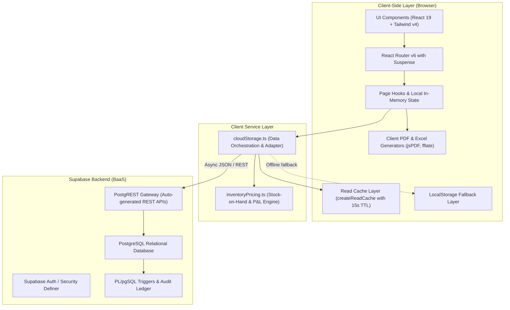

# 📓 Chapter 01: System Overview & Architecture

## 1. Executive Summary & Business Context

**Sai Gayatri Industries** is a specialized manufacturing and distribution enterprise producing disposable paper/plastic plates, bowls, packaging materials, and allied industrial paper goods.

Before the development of this platform, business operations relied on error-prone paper daybooks, spreadsheets, and manual calculations. This caused common operational bottlenecks:
- **Stock Discrepancies**: Raw sheets and plates were delivered in bulk batches with fluctuating supplier prices and transportation fees, leading to inaccurate landed cost calculations.
- **Billing Inaccuracies**: Sales staff had to manually look up prices, apply discounts, track partial cash/online payments, and calculate remaining balances.
- **Lost Inquiries**: Prospective customer orders were tracked on scraps of paper, making delivery tracking difficult.
- **Untracked Overhead**: Factory running costs (machinery parts, heating coils, dies, electricity, petrol) were unlinked from revenue, obscuring real net profitability.

The **Sai Gayatri Industries ERP System** is a modern, responsive web application engineered to solve these challenges with high auditability, sub-second reactivity, offline-resilient local fallbacks, and multi-format reporting.

---

## 2. High-Level System Architecture

The application adopts a **Modern Client-Cloud Jamstack Architecture** with a strict separation between presentation, state orchestration, caching, and persistent relational storage:



---

## 3. Technology Stack & Decision Rationale

| Layer | Technology | Version | Rationale & Advantage |
| :--- | :--- | :--- | :--- |
| **Frontend Framework** | React | `^19.2.8` | Latest React engine featuring automatic batching, modern concurrency, and sub-millisecond render trees. |
| **Language** | TypeScript | `~6.0.2` | Full end-to-end type safety, typed Supabase schemas, and compile-time error prevention. |
| **Bundler & Tooling** | Vite | `^8.2.2` | Sub-second Hot Module Replacement (HMR) and optimized Rollup-based tree-shaken production bundles. |
| **Styling** | Tailwind CSS | `^4.3.3` | Next-gen CSS-first Tailwind engine (`@tailwindcss/postcss`) providing zero-runtime styling and an industrial aesthetic. |
| **Routing** | React Router DOM | `^6.30.6` | Declarative client-side routing, URL search parameter synchronization, and route-level code splitting via `React.lazy`. |
| **Backend / DB** | Supabase & PostgreSQL | `^2.116.0` | Production PostgreSQL database, real-time Row Level Security (RLS), and automated PostgREST REST APIs. |
| **Document Generation** | jsPDF & AutoTable | `^4.2.1` / `^5.0.8` | Direct client-side generation of industrial tax/sales invoices and landscape monthly financial audit PDFs. |
| **Data Export** | fflate | `^0.8.3` | High-speed, lightweight in-memory zip/compression engine used for instant business workbook creation. |

---

## 4. UI/UX Design Philosophy

The user interface was crafted to embody an **Industrial Craftsmanship** visual language:
1. **Color Palette**:
   - Primary Brand Ink: Deep forest teal (`#123f3a`, `#0f6b63`).
   - Accent & Highlights: Mint emerald (`#8ddfc2`, `#dce9e3`).
   - Surfaces: Off-white canvas with slight mint warmth (`#f7faf8`, `#f9fffd`).
   - Typography: Clean, legible sans-serif with high-contrast slate text (`text-slate-800`).
2. **Layout Structure**:
   - **Persistent Desktop Sidebar**: Categorized navigation (Dashboard, Sales, Inventory, Orders, Expenses, Master Data, Reports).
   - **Floating Topbar**: Fast search bar, brand identity monogram, live connection indicator, and instant shortcuts.
   - **Mobile Bottom Navigation**: Bottom sheet bar with touch-friendly navigation pills optimized for factory floor operation.
3. **Ergonomic Data Entry**:
   - Automatic decimal and Indian Rupee (`₹`) formatting.
   - Dynamic product rows in sales and order forms with quick add/remove.
   - Visual KPI cards with percentage progress and status badges (`Paid`, `Partial`, `Unpaid`).

---

## 5. Repository & Directory Structure

```text
sai-gayatri-industries-ui-ux-design/
├── docs/                               # Comprehensive learning notebooks & guides
│   ├── README.md                       # Master documentation index
│   ├── 01_SYSTEM_OVERVIEW_AND_ARCHITECTURE.md
│   ├── 02_FRONTEND_ENGINEERING_DEEP_DIVE.md
│   ├── 03_MODULES_WORKFLOW_AND_LOGIC.md
│   ├── 04_BACKEND_SUPABASE_AND_SQL_DATABASE.md
│   ├── 05_DATA_FLOW_AND_STORAGE_LIFECYCLE.md
│   ├── 06_INTERVIEW_PREPARATION_AND_QA_GUIDE.md
│   └── SAI_GAYATRI_FULL_SYSTEM_NOTEBOOK.md
├── public/                             # Public static assets (logos, icons, favicons)
│   ├── brand-mark.png                  # Invoice high-resolution company mark
│   ├── brand-mark.svg
│   └── favicon.svg
├── src/                                # Application source code
│   ├── assets/                         # SVG & graphic assets
│   ├── components/                     # Reusable UI component modules
│   │   ├── EmptyState/                 # Generic zero-state placeholder
│   │   ├── Inventory/                  # Inventory-specific modals & receipts
│   │   ├── Layout/                     # Sidebar, Topbar, BottomNav
│   │   ├── Reports/                    # Monthly drill-down reports & tables
│   │   └── SaleForm/                   # SaleForm and ProductRow line-item editor
│   ├── pages/                          # Routed view screens
│   │   ├── AddInventory.tsx            # Redirect helper to /inventory
│   │   ├── BusinessExpenses.tsx        # Factory overhead expense tracking
│   │   ├── Home.tsx                    # Executive KPI dashboard & recent sales
│   │   ├── Inventory.tsx               # Stock receipts and intake history
│   │   ├── MasterData.tsx              # Customer & Supplier management
│   │   ├── NewSale.tsx                 # Invoice creation & editing view
│   │   ├── OrderQueries.tsx            # Pre-orders & inquiry pipeline (Kanban)
│   │   ├── ProductMaster.tsx           # SKU catalog & stock receipt ledger
│   │   ├── Reports.tsx                 # Analytical dashboard, filters & exports
│   │   └── Sales.tsx                   # Sales invoice ledger & PDF downloads
│   ├── utils/                          # Core business logic & utility modules
│   │   ├── businessExport.ts           # Excel (XLSX) & JSON backup exporter
│   │   ├── calculations.ts             # Line item math & subtotal helpers
│   │   ├── cloudStorage.ts             # Supabase cloud adapter & cache layer
│   │   ├── inventoryHistoryPdf.ts      # Product intake history PDF generator
│   │   ├── inventoryPricing.ts         # Real-time stock-on-hand & P&L engine
│   │   ├── storage.ts                  # Types, currency formatters & localStorage
│   │   └── supabase.ts                 # Supabase client instantiation
│   ├── App.css
│   ├── App.tsx                         # Main route configuration & shell layout
│   ├── index.css                       # Global styles & Tailwind CSS definitions
│   └── main.tsx                        # React application mounting point
├── supabase/                           # Database migrations & schemas
│   ├── migrations/                     # Incremental SQL migrations
│   │   ├── 20261007_stock_intakes.sql  # Intake ledger & cutover migration
│   │   └── 20261018_audited_inventory_edits.sql # Audit triggers & immutable rules
│   └── schema.sql                      # Complete consolidated PostgreSQL schema
├── index.html                          # HTML5 shell entry
├── package.json                        # Node dependencies & build scripts
├── tsconfig.json                       # TypeScript compiler configuration
└── vite.config.ts                      # Vite build & plugin configuration
```
