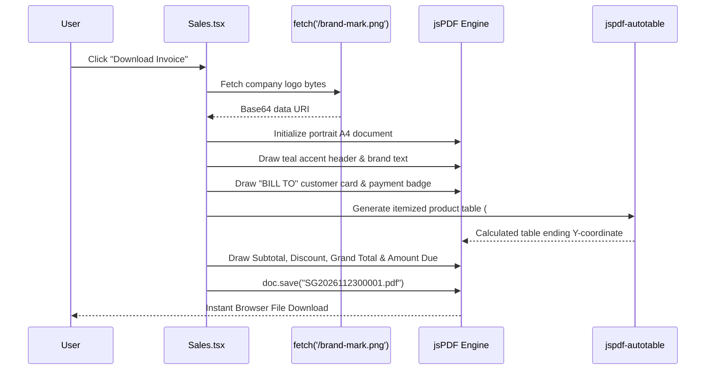

# 📓 Chapter 02: Frontend Engineering Deep Dive

## 1. React 19 Application Architecture & Shell (
AI Overview

React 19 is a major version of the React JavaScript library)

The application is structured using **React 19** with functional components and modern hook-driven state machines.

### Lazy Loading & Code Splitting (`App.tsx`)
To ensure optimal initial page load times on low-bandwidth mobile networks or factory devices, all top-level routes are loaded lazily via `React.lazy()` wrapped in a shared `<Suspense>` boundary:

```tsx
import { lazy, Suspense } from 'react'
import { Routes, Route, Navigate } from 'react-router-dom'
import Sidebar from './components/Layout/Sidebar'
import Topbar from './components/Layout/Topbar'
import BottomNav from './components/Layout/BottomNav'

const Home = lazy(() => import('./pages/Home'))
const Sales = lazy(() => import('./pages/Sales'))
const NewSale = lazy(() => import('./pages/NewSale'))
const ProductMaster = lazy(() => import('./pages/ProductMaster'))
const Reports = lazy(() => import('./pages/Reports'))
const OrderQueries = lazy(() => import('./pages/OrderQueries'))
const BusinessExpenses = lazy(() => import('./pages/BusinessExpenses'))
const MasterData = lazy(() => import('./pages/MasterData'))

export default function App() {
  return (
    <div className="min-h-screen w-full text-slate-800 app-background">
      <div className="mx-auto flex max-w-[1600px] px-2 py-2 sm:px-3 lg:px-4">
        <Sidebar />
        <div className="flex min-h-screen flex-1 flex-col overflow-hidden rounded-[30px] border border-[#dce8e3] bg-[#f7faf8]/95 shadow-[0_25px_70px_rgba(18,63,56,0.12)] backdrop-blur-sm">
          <Topbar />
          <main className="flex-1 px-4 py-6 sm:px-6 lg:px-8">
            <Suspense fallback={<RouteLoadingSpinner />}>
              <Routes>
                <Route path="/" element={<Navigate to="/home" replace />} />
                <Route path="/home" element={<Home />} />
                <Route path="/sales" element={<Sales />} />
                <Route path="/sales/new" element={<NewSale />} />
                <Route path="/inventory" element={<ProductMaster />} />
                <Route path="/reports" element={<Reports />} />
                <Route path="/orders" element={<OrderQueries />} />
                <Route path="/expenses" element={<BusinessExpenses />} />
                <Route path="/customers" element={<MasterData mode="customers" />} />
                <Route path="/suppliers" element={<MasterData mode="suppliers" />} />
              </Routes>
            </Suspense>
          </main>
        </div>
      </div>
      <BottomNav />
    </div>
  )
}
```

---

## 2. In-Memory Read Caching Engine (`createReadCache`)

Network calls across multiple pages (e.g., navigating between Home, Sales, and Reports) often request identical datasets (`getCloudSalesRecords`, `getCloudInventoryItems`, `getCloudProductMasterItems`).

To eliminate redundant network round trips while guaranteeing that mutations immediately show fresh data, `src/utils/cloudStorage.ts` implements a custom **Time-To-Live (TTL) Generation Cache**:

```typescript
function createReadCache<T>(load: () => Promise<T>) {
  let value: T | undefined
  let expiresAt = 0
  let generation = 0
  let pending: Promise<T> | null = null

  return {
    get() {
      // 1. If valid cached value exists and hasn't expired, return instantly
      if (value !== undefined && Date.now() < expiresAt) return Promise.resolve(value)
      
      // 2. If a request is already inflight, deduplicate and share the promise
      if (pending) return pending

      const requestGeneration = generation
      pending = load()
        .then((result) => {
          // 3. Ensure the generation didn't change while waiting
          if (generation === requestGeneration) {
            value = result
            expiresAt = Date.now() + 15_000 // 15 seconds TTL
          }
          return result
        })
        .finally(() => {
          if (generation === requestGeneration) pending = null
        })
      return pending
    },
    invalidate() {
      // 4. Invalidate triggers an increment of generation and wipes cache
      generation += 1
      value = undefined
      expiresAt = 0
      pending = null
    }
  }
}
```

### Key Engineering Advantages:
1. **Request Deduplication**: If 3 components mount simultaneously and call `getCloudProductMasterItems()`, only **one** HTTP request is sent over the wire.
2. **Instant Navigation**: Page switches feel instantaneous because data loads synchronously from memory within the 15-second window.
3. **Immediate Cache Eviction on Mutation**: When a new sale or stock intake is saved, `salesCache.invalidate()` or `inventoryCache.invalidate()` is called, ensuring the next read fetches live data.

---

## 3. Dynamic Form State Management (`SaleForm.tsx`)

The sales entry form allows cashiers or factory managers to dynamically compose complex sales orders with multiple product rows, real-time math calculations, and customer lookup:

### Dynamic Row State Machine
```typescript
type Product = {
  id?: string
  name?: string
  quantity?: number
  purchaseCost?: number
  selling?: number
}

// In SaleForm.tsx
const [products, setProducts] = useState<Product[]>([{}])

const updateProduct = (index: number, changes: Partial<Product>) => {
  setProducts((prev) =>
    prev.map((item, itemIndex) =>
      itemIndex === index ? { ...item, ...changes } : item
    )
  )
}

const addProduct = () => {
  if (products.length >= 8) return // Guard against excessive invoice length
  setProducts((prev) => [...prev, {}])
}

const removeProduct = (index: number) => {
  setProducts((prev) => prev.filter((_, itemIndex) => itemIndex !== index))
}
```

### Live Totals Computation with `useMemo`
```typescript
const totals = useMemo(() => {
  const totalPlates = products.reduce((sum, item) => sum + (Number(item.quantity) || 0), 0)
  const subtotal = products.reduce(
    (sum, item) => sum + (Number(item.quantity) || 0) * (Number(item.selling) || 0),
    0
  )
  const safeAmountPaid =
    paymentStatus === 'Paid' ? subtotal : paymentStatus === 'Partial' ? amountPaid : 0
  const grandTotal = subtotal - discount
  const remaining = Math.max(0, grandTotal - safeAmountPaid)

  return { totalPlates, subtotal, grandTotal, remaining, safeAmountPaid }
}, [products, amountPaid, discount, paymentStatus])
```

---

## 4. Client-Side Document & Invoice Generation

### Professional Sales Invoices (`jsPDF` + `jspdf-autotable`)
Instead of relying on server-side PDF renderers (which introduce latency and cold starts), the system generates publication-ready A4 PDF invoices directly in the user's browser in `Sales.tsx`:



#### Key Styling Attributes in Generated Invoices:
- **Teal Industrial Header Accent**: `doc.setFillColor(18, 83, 73)` with a top border band.
- **Embedded Brand Mark**: High-resolution rasterized monogram loaded through binary array buffers and converted to base64.
- **Typography & Grid**: Helvetica bold/normal with strict micro-spacing in millimeters (`mm`).
- **Payment Badging**: Clear status indicators (`PAID`, `PARTIAL`, `UNPAID`) rendered with contrast background panels.

---

## 5. Multi-Format Business Data Backup & Export

In `src/utils/businessExport.ts`, users can export the entirety of their enterprise data in two industry-standard formats:

### 1. Multi-Sheet Excel Workbook (`downloadBusinessWorkbook`)
Exports a consolidated workbook with dedicated sheets:
1. **Sales Register**: Every sale, invoice ID, customer, total plates, grand total, payment status.
2. **Sales Line Items**: Detailed breakdown of every item sold across all invoices.
3. **Inventory & Intakes**: All stock receipts, batch IDs, unit costs, and suppliers.
4. **Product Catalog**: Master SKU list, units, and minimum stock warnings.
5. **Business Expenses**: All operational expenditure records.
6. **Customer & Supplier Directory**: Complete contact ledgers.

### 2. JSON Backup Snapshot (`downloadBusinessJsonBackup`)
Produces a timestamped JSON file containing the complete relational database state. This allows offline archiving and disaster recovery with zero data loss.
