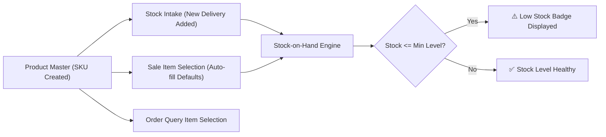
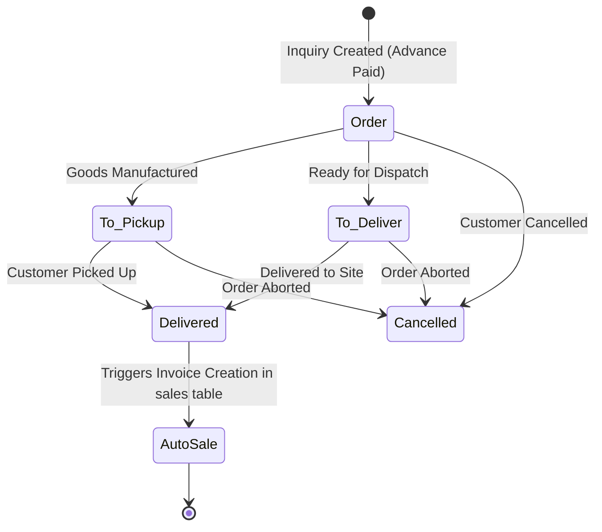

# 📓 Chapter 03: Modules, Workflow & Business Logic

## 1. Product Master & SKU Management

The **Product Master** (`src/pages/ProductMaster.tsx`) serves as the single source of truth for all manufactured and traded items across the factory.

### Key Attributes
- **Product ID / SKU**: Unique identifier (e.g., `PL-07-SHT`, `BW-100-WHT`).
- **Product Name**: Display name (e.g., `7 Inch Silver Plate Sheet`, `100ml Heavy Bowl`).
- **Category**: Product line classification (`Plates`, `Bowls`, `Raw Material`, `General`).
- **Unit of Measurement**: Selected from standard industrial units: `Sheet`, `Piece`, `Bowl`, `Box`, `Kg`, `Gram`, `Litre`, `Pack`, `Set`, `Roll`, `Dozen`.
- **Default Purchase Cost & Default Selling Price**: Standard price defaults populated into intake and sales forms.
- **Minimum Stock Level Alert**: If `stockOnHand <= minimumStockLevel`, the system triggers visual low-stock badges to prevent factory production shortages.



---

## 2. Stock Intake Ledger & Audited Receipts

Unlike traditional CRUD apps that allow unrestricted overwrites of inventory quantities, Sai Gayatri Industries implements an **Append-Only Delivery Ledger**:

1. **Batch Intake Submissions**: Deliveries arrive from suppliers in batches. Each intake row captures:
   - `date`: Date of delivery receipt.
   - `supplier`: Supplier company or individual name.
   - `quantity`: Number of sheets/units received.
   - `cost_price`: Specific purchase cost per unit for this delivery.
   - `transport_cost`: Freight or delivery charges allocated to this batch.
   - `type`: `Purchased` or `Factory Produced`.
   - `intake_batch_id`: A UUID linking all line items received on that truck or delivery run.
2. **Immutability & Auditing**:
   - Stock intake records **cannot be deleted**.
   - If an error was made on a quantity or price, updating the receipt automatically fires the PostgreSQL trigger `audit_stock_intake_update()`, logging the `old_values` and `new_values` into `stock_intake_audit`.

---

## 3. Real-Time Stock-on-Hand & Valuation Algorithm

Stock balances and cost metrics are computed deterministically in `src/utils/inventoryPricing.ts` via `getInventoryProducts()`.

### The Core Formula:
$$\text{Stock on Hand} = \sum (\text{Intake Quantities}) - \sum (\text{Tracked Sold Quantities})$$

### The Migration Cutover Mechanism:
When migrating from legacy paper balances or early prototypes to the modern intake ledger:
1. Historical legacy intake entries already reflected prior sales.
2. Deducting all sales throughout time would cause a double deduction error.
3. The system stores `sales_stock_tracking_started_at` in table `stock_intake_settings`.
4. Sales made **before** this cutover timestamp are recorded for financial reports, but **only sales created after this timestamp** are deducted from the active stock-on-hand ledger.

### Cost Metric Calculations:
- **Latest Purchase Cost**: Cost per sheet from the most recent intake record by date.
- **Weighted Average Cost**:
  $$\text{Average Cost} = \frac{\sum (\text{Received Quantity}_i \times \text{Cost per Sheet}_i)}{\sum \text{Received Quantity}_i}$$
- **Highest & Lowest Cost**: Minimum and maximum historical procurement prices for price fluctuation trend analysis.

---

## 4. Sales & Invoicing Workflow

The Sales module (`src/pages/Sales.tsx` & `src/pages/NewSale.tsx`) manages customer billing, line item composition, and invoice tracking.

### 1. Serialized Invoice ID Generation (`SGYYYYMMDD00001`)
In `src/utils/cloudStorage.ts`, `getNextInvoiceId(saleDate)` queries existing records for that date prefix and produces a monotonic sequential ID:

```typescript
export async function getNextInvoiceId(saleDate: string) {
  const client = requireSupabase()
  const datePart = saleDate.replaceAll('-', '') // e.g. "20261123"
  const prefix = `SG${datePart}`
  const { data, error } = await client
    .from('sales')
    .select('id')
    .like('id', `${prefix}%`)
    .order('id', { ascending: false })
    .limit(1)

  if (error) throw error

  const latestId = data?.[0]?.id ? String(data[0].id) : ''
  const latestSequence = latestId.startsWith(prefix) ? Number(latestId.slice(prefix.length)) : 0
  const nextSequence = Number.isFinite(latestSequence) ? latestSequence + 1 : 1
  return `${prefix}${String(nextSequence).padStart(5, '0')}`
}
```

### 2. Live Financial Calculations
- **Subtotal**: $\sum (\text{Line Quantity} \times \text{Line Selling Price})$
- **Grand Total**: $\text{Subtotal} - \text{Discount}$
- **Payment Status Transition**:
  - `Paid`: Customer cleared full amount ($\text{Remaining} = 0$).
  - `Partial`: Customer provided partial advance payment ($\text{Remaining} = \text{Grand Total} - \text{Amount Paid}$).
  - `Unpaid`: No payment collected ($\text{Amount Paid} = 0, \text{Remaining} = \text{Grand Total}$).

---

## 5. Order Queries & Inquiry Pipeline

Prospective orders, catering inquiries, and advance bookings are managed in `src/pages/OrderQueries.tsx`.



### Auto-Conversion to Sales on Delivery:
When a factory manager marks an inquiry as `stage === 'Delivered'`, the system automatically:
1. Generates the next official invoice ID via `getNextInvoiceId(orderDate)`.
2. Inserts an official record into `public.sales` and line items into `public.sale_products`.
3. Links `order_queries.sale_id` to the newly generated invoice ID.
4. Deducts the quantities from current stock-on-hand.

---

## 6. Customers & Suppliers Master Data

Managed in `src/pages/MasterData.tsx`:
- **Customers**: Name and 10-digit mobile number. Phone numbers are sanitized (`mobile.replace(/\D/g, '')`) to prevent duplicates.
- **Suppliers**: Supplier name and contact information. When logging stock intakes, suppliers are auto-suggested.

---

## 7. Business Operational Expenses

Operating an industrial plate factory involves ongoing factory costs beyond raw materials. `src/pages/BusinessExpenses.tsx` tracks 12 discrete expenditure categories:

1. `Rent` (Factory shed & warehouse lease)
2. `Meshinery expnce` (Machine repair, spare parts, bearings)
3. `Curent bil` (Industrial high-voltage electricity bill)
4. `Termosat` (Temperature sensor replacement for heating plates)
5. `Petrol` (Delivery vehicles and generators)
6. `Heating coil` (High-wear heating elements for forming dies)
7. `rechege` (Telecom & internet)
8. `Hydrolic oil` (Hydraulic press lubricants & fluid top-ups)
9. `own expences` (Owner daily operational allowance)
10. `Die` (Custom die tooling for distinct plate diameters)
11. `Trasport charges` (Inbound freight & local logistics)
12. `Stock purchase` (Incidental packaging stock)

---

## 8. Reports & Analytical Profit Engine

The Reports screen (`src/pages/Reports.tsx` & `MonthlyReport.tsx`) consolidates data across Sales, Stock Intakes, and Expenses to compute true operating margins:

### Date Filtering Options:
- `Today`
- `This Week`
- `This Month`
- `Last Month`
- `Custom Range` (User-defined start and end dates)

### Profit & Loss (P&L) Computation:
$$\text{Net Profit} = \text{Gross Revenue} - \text{COGS (Cost of Goods Sold)} - \text{Operating Expenses}$$

Where:
- $\text{Gross Revenue} = \sum \text{sales.grand\_total}$
- $\text{COGS} = \sum (\text{sale\_products.quantity} \times \text{sale\_products.purchase\_cost})$
- $\text{Operating Expenses} = \sum \text{business\_expenses.amount}$
