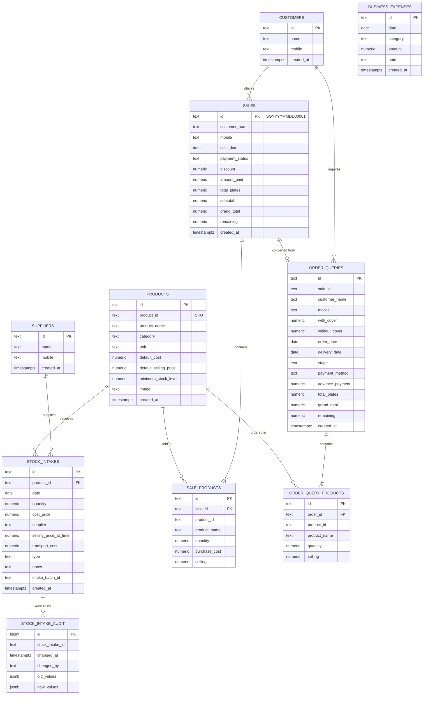

# 📓 Chapter 04: Backend, Supabase & SQL Database

## 1. Relational Database Schema Overview

The backend is built on **PostgreSQL**, hosted and managed through **Supabase**. The schema guarantees relational integrity through Foreign Key constraints, cascade behaviors, normalized unique indexes, and Row Level Security (RLS).

---

## 2. Entity-Relationship (ER) Diagram



---

## 3. Data Dictionary & Table Definitions

### 1. `products` (Product Master Catalog)
Stores every physical item profile:
```sql
create table if not exists public.products (
  id text primary key,
  product_id text not null,
  product_name text not null,
  category text not null default 'General',
  unit text not null default 'Sheet',
  default_cost numeric not null default 0,
  default_selling_price numeric not null default 0,
  minimum_stock_level numeric not null default 0,
  image text,
  created_at timestamptz not null default now()
);

-- Case-insensitive trimmed unique indexes prevent duplicate product codes or duplicate titles
create unique index if not exists products_product_id_normalized_uidx
  on public.products (lower(trim(product_id)));

create unique index if not exists products_product_name_normalized_uidx
  on public.products (lower(trim(product_name)));
```

### 2. `stock_intakes` (Inbound Delivery Ledger)
Captures every delivery of raw sheets or finished plates:
```sql
create table if not exists public.stock_intakes (
  id text primary key,
  product_id text not null references public.products(id) on update cascade,
  date date not null,
  quantity numeric not null,
  cost_price numeric not null,
  supplier text not null default '',
  selling_price_at_time numeric,
  transport_cost numeric not null default 0,
  type text not null default 'Purchased',
  notes text not null default '',
  intake_batch_id text not null default gen_random_uuid()::text,
  created_at timestamptz not null default now()
);

create index if not exists stock_intakes_product_date_idx
  on public.stock_intakes (product_id, date desc, created_at desc);
```

### 3. `stock_intake_audit` (Audit Log for Corrections)
Records an immutable JSONB diff whenever a stock delivery receipt is modified:
```sql
create table if not exists public.stock_intake_audit (
  id bigint generated by default as identity primary key,
  stock_intake_id text not null,
  changed_at timestamptz not null default now(),
  changed_by text not null,
  old_values jsonb not null,
  new_values jsonb not null
);

create index if not exists stock_intake_audit_intake_idx
  on public.stock_intake_audit (stock_intake_id, changed_at desc);
```

### 4. `sales` & `sale_products` (Invoicing & COGS Tracking)
Header-detail pattern for customer sales. Notice `purchase_cost` in `sale_products` which captures procurement cost at the time of sale for exact profit margin tracking:
```sql
create table if not exists public.sales (
  id text primary key, -- Formatted: SGYYYYMMDD00001
  customer_name text not null,
  mobile text not null,
  sale_date date not null,
  payment_status text not null check (payment_status in ('Paid', 'Unpaid', 'Partial')),
  discount numeric not null default 0,
  amount_paid numeric not null default 0,
  total_plates numeric not null default 0,
  subtotal numeric not null default 0,
  grand_total numeric not null default 0,
  remaining numeric not null default 0,
  created_at timestamptz not null default now()
);

create table if not exists public.sale_products (
  id text primary key,
  sale_id text not null references public.sales(id) on delete cascade,
  product_id text not null,
  product_name text not null,
  quantity numeric not null default 0,
  purchase_cost numeric not null default 0,
  selling numeric not null default 0
);
```

---

## 4. PL/pgSQL Triggers & Stored Functions

To guarantee strict enterprise compliance on the factory floor, business rules are enforced directly inside the database engine:

### Trigger 1: Stock Intake Modification Audit (`audit_stock_intake_update`)
Whenever a stock receipt is edited, this trigger fires before the update and writes a complete snapshot of `old` and `new` tuples as JSONB:

```sql
create or replace function public.audit_stock_intake_update()
returns trigger
language plpgsql
security definer
set search_path = public
as $$
begin
  insert into public.stock_intake_audit (stock_intake_id, changed_by, old_values, new_values)
  values (old.id, coalesce(auth.uid()::text, current_user), to_jsonb(old), to_jsonb(new));
  return new;
end;
$$;

create trigger stock_intakes_audit_updates
  before update on public.stock_intakes
  for each row execute function public.audit_stock_intake_update();
```

### Trigger 2: Prevent Deletion of Stock Receipts (`reject_stock_intake_delete`)
Physical deliveries cannot simply disappear from the books. Deletion attempts are hard-rejected at the database level:

```sql
create or replace function public.reject_stock_intake_delete()
returns trigger
language plpgsql
as $$
begin
  raise exception 'Stock receipts cannot be deleted. Edit the receipt instead so the correction is audited.';
end;
$$;

create trigger stock_intakes_prevent_delete
  before delete on public.stock_intakes
  for each row execute function public.reject_stock_intake_delete();
```

---

## 5. Row Level Security (RLS) Policies

All tables have Row Level Security enabled (`alter table public.<table_name> enable row level security;`).

In the current operational phase, public access policies permit trusted client access authenticated by the Supabase publishable anonymous key, while restricting direct tampering through database triggers:

```sql
create policy "public products access" on public.products for all using (true) with check (true);
create policy "public stock intakes access" on public.stock_intakes for all using (true) with check (true);
create policy "public stock intake audit read" on public.stock_intake_audit for select using (true);
create policy "public sales access" on public.sales for all using (true) with check (true);
create policy "public sale products access" on public.sale_products for all using (true) with check (true);
create policy "public order queries access" on public.order_queries for all using (true) with check (true);
create policy "public business expenses access" on public.business_expenses for all using (true) with check (true);
```
