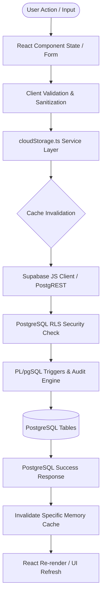
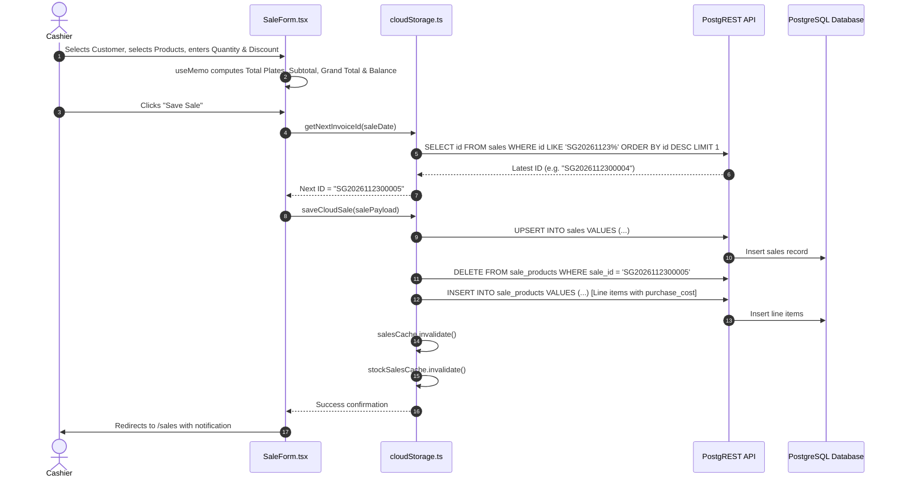
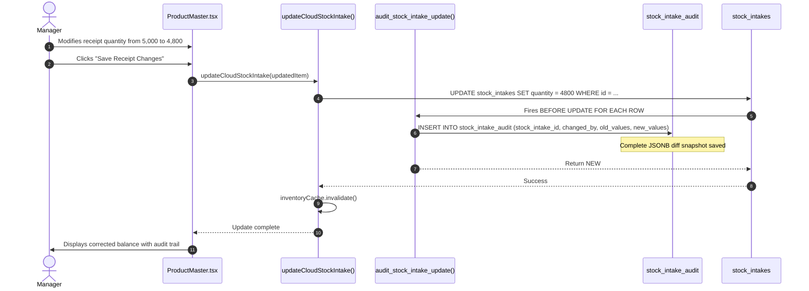

# 📓 Chapter 05: Data Flow & Storage Lifecycle

## 1. End-to-End Data Flow Overview

Every transaction in the Sai Gayatri Industries system follows a disciplined, predictable lifecycle from the user's keystroke down to the PostgreSQL disk blocks and back to the UI.



---

## 2. Deep Dive: Creating a Sale Order

When a user records a customer purchase on `/sales/new`, here is the exact chronological sequence:



---

## 3. Deep Dive: Receiving Stock & Auditing Corrections

Stock receipts are mission-critical because they establish raw inventory balances and procurement valuation.

### A. New Stock Intake Flow
1. Cashier opens the "Add Stock" modal in `ProductMaster.tsx`.
2. Enters batch date, supplier name, quantity, purchase cost per unit, and transport charges.
3. `saveCloudStockIntakes()` verifies all batch rows share one supplier and receipt date.
4. Generates an `intake_batch_id` UUID grouping the delivery.
5. Performs a batch insert into `public.stock_intakes`.
6. Calls `inventoryCache.invalidate()`.
7. `getInventoryProducts()` recalculates live Stock-on-Hand and weighted average costs across all products.

### B. Audited Correction Flow
If a cashier realizes they entered an incorrect quantity or price:



---

## 4. Intelligent Error Translation (`describeCloudError`)

Raw database errors from PostgreSQL or PostgREST are cryptic to end users (e.g., `42P01` or `23505`).

In `src/utils/cloudStorage.ts`, the `describeCloudError()` utility intercepts and translates these codes into actionable, plain-English instructions:

```typescript
export function describeCloudError(error: unknown, fallback: string) {
  if (error && typeof error === 'object') {
    const details = error as { message?: string; details?: string; hint?: string; code?: string }
    
    // Missing table error
    if (details.code === '42P01' || details.message?.toLowerCase().includes('does not exist')) {
      return `${fallback} The new tool tables are not installed in Supabase yet. Run the latest SQL from supabase/schema.sql, then refresh.`
    }
    // RLS permission denial
    if (details.code === '42501' || details.message?.toLowerCase().includes('row-level security')) {
      return `${fallback} Supabase permissions are blocking this action. Run the latest RLS policy SQL from supabase/schema.sql.`
    }
    // Foreign key violation
    if (details.code === '23503') {
      return `${fallback} A linked database record is missing. Check that the sales and sale_products tables were created from the latest schema.`
    }
    // Unique constraint violation (duplicate key)
    if (details.code === '23505') {
      return `${fallback} A product ID/name or intake record already exists. Check for a duplicate and try again.`
    }
    // PostgREST schema cache out of sync
    if (details.code === 'PGRST204' || details.message?.toLowerCase().includes('schema cache')) {
      return `${fallback} Supabase is missing a required column. Run the latest migration SQL in supabase/schema.sql, then run notify pgrst, 'reload schema'; and wait 30 seconds before retrying.`
    }
  }
  if (error instanceof Error) return error.message
  return fallback
}
```

---

## 5. Offline Resiliency & Fallback Local Storage

In `src/utils/storage.ts`, fallback helper functions are maintained (`readStorage`, `writeStorage`, `getInventoryItems`, `saveInventoryItems`).

When running in offline demonstration environments without internet access or during local mock testing:
- Components can fall back to browser `localStorage`.
- Data is serialized as JSON strings with defensive error boundaries (`try...catch`).
- Ensures zero UI crashes if third-party network gateways are unreachable.
