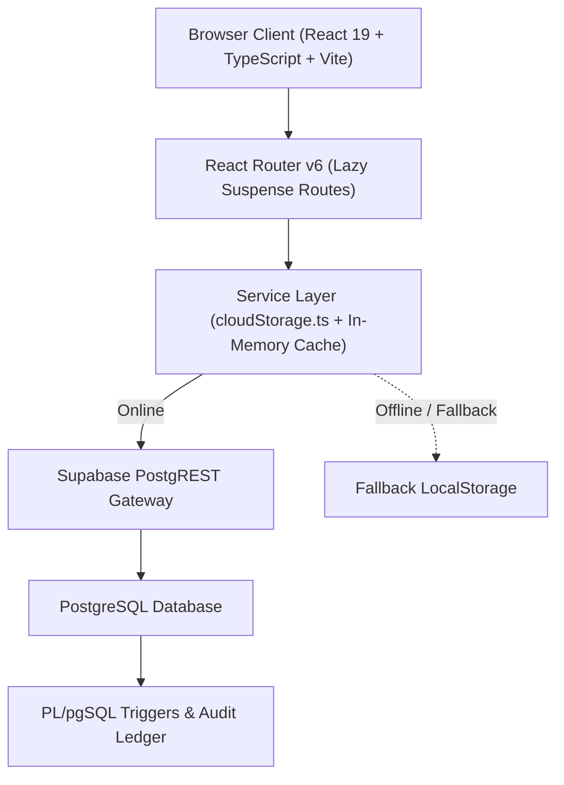

# 📘 Sai Gayatri Industries — Architecture & Learning Notebooks

Welcome to the comprehensive technical documentation and interview preparation guide for the **Sai Gayatri Industries ERP & Inventory Management System**.

This documentation is structured in a clear, notebook-style format designed for deep learning, architectural understanding, and interview mastery.

---

## 📚 Notebook Chapters

| Chapter | Title | Focus Area |
| :--- | :--- | :--- |
| **[01. System Overview & Architecture](file:///docs/01_SYSTEM_OVERVIEW_AND_ARCHITECTURE.md)** | Core Overview & Blueprint | High-level system design, UI/UX philosophy, full directory tree, tech stack rationale. |
| **[02. Frontend Engineering Deep Dive](file:///docs/02_FRONTEND_ENGINEERING_DEEP_DIVE.md)** | UI & Client Architecture | React 19, TypeScript, Vite, TailwindCSS v4, route splitting, in-memory read caching, client-side PDF & Excel generation. |
| **[03. Modules, Workflow & Logic](file:///docs/03_MODULES_WORKFLOW_AND_LOGIC.md)** | Business Modules & Workflows | Product Master, Stock Intakes, Stock-on-Hand algorithms, Sales & Invoice generation, Order Pipeline, Expenses, Reports & P&L. |
| **[04. Backend, Supabase & SQL Database](file:///docs/04_BACKEND_SUPABASE_AND_SQL_DATABASE.md)** | Data Layer & Database Architecture | PostgreSQL schema, ER Diagram, PL/pgSQL audit triggers, immutability, RLS policies, PostgREST API. |
| **[05. Data Flow & Storage Lifecycle](file:///docs/05_DATA_FLOW_AND_STORAGE_LIFECYCLE.md)** | End-to-End Data Lifecycle | Detailed sequence diagrams, client-to-cloud journey, cache invalidation, error handling, local storage fallback. |
| **[06. Interview Preparation & QA Guide](file:///docs/06_INTERVIEW_PREPARATION_AND_QA_GUIDE.md)** | Interview Mastery Playbook | 30-sec/2-min elevator pitches, 30+ technical & architectural Q&As, resume bullet points, tricky edge-case explanations. |
| **[All-in-One Master Notebook](file:///docs/SAI_GAYATRI_FULL_SYSTEM_NOTEBOOK.md)** | Complete Unified Handbook | All chapters combined into a single, printable, end-to-end master learning notebook. |

---

## 🎯 Quick Architecture At A Glance

---

## 💡 How to Use These Notebooks
1. **For Learning & Code Exploration**: Start with **Chapters 01, 02, and 03** to master how the frontend components, algorithms, and styling fit together.
2. **For Database & Backend Skills**: Study **Chapters 04 and 05** to learn professional PostgreSQL relational schema design, triggers, audit trails, and caching.
3. **For Job Interviews**: Go straight to **Chapter 06** to practice answering system design, frontend, and database questions about this project.
